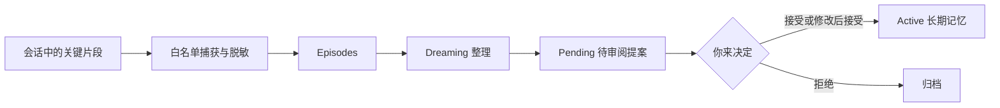

<div align="center">

# dsh-memory

### 下一个会话，不必从零开始。

**为 DSH 打造的原生长期记忆插件。**

记住做过的项目、踩过的坑、形成的规则与你的偏好。<br>
在需要的时候想起，在不需要的时候安静。

[项目简介](#项目简介) · [使用场景](#使用场景) · [工作方式](#工作方式) · [管理体验](#管理体验) · [隐私与安全](#隐私与安全) · [安装](#安装) · [配置](#配置) · [架构说明](#架构说明) · [发布说明](#发布说明) · [FAQ](#faq)

[](#开发进度)
[](#安装)
[](#许可证)
[](#隐私与安全)

</div>

> [!NOTE]
> **当前为 `0.1.0` 开发版本（0.x），仅以 GitHub 插件形式通过 GitHub Releases 分发，不发布 npm 包。**
>
> 本文描述的能力与当前仓库实现保持同步；在达到正式稳定版前，界面、配置与行为仍可能调整。详细变更见 [`CHANGELOG.md`](CHANGELOG.md)。

---

<p align="center">
  <strong>赞助商 · 感谢支持 dsh-memory 开源开发</strong>
  <br>
  <a href="https://api.lwxiaoye.top/">
    
  </a>
  <br>
  <a href="https://api.lwxiaoye.top/">XiaoyeyeyeyeyeAPI · 访问赞助商网站</a>
</p>

## 项目简介

每个新会话，编程 Agent 都可能从零开始：重新理解项目，重新询问约定，甚至再次犯下已经被纠正过的错误。

**dsh-memory 想让经验跨会话留下来。**

它不是另一份完整聊天记录，也不是把全部历史塞进上下文，而是一套围绕 DSH 会话生命周期设计的经验记忆系统：

- **记住纠正**：一次踩坑，沉淀为以后可以复用的教训。
- **记住工作**：知道上次做了什么、做到哪里、留下了什么结果。
- **记住项目**：把散落的架构约定、命令和关键决策整理成项目知识。
- **记住你**：保存少量真正长期有效的跨项目偏好。
- **把控制权留给你**：查看来源、审阅提案、修改内容、遗忘或永久删除。

<div align="center">

**捕获经验 → 整理知识 → 人工审阅 → 按需召回**

</div>

## 使用场景

### 不再重复同一个错误

上周，你在项目里纠正过：

> 构建前先运行 typecheck，不要等到打包时才发现类型错误。

在新的会话中，当你再次处理构建相关任务，dsh-memory 的目标是把这条与当前请求相关的教训带回上下文。你不必重新解释，Agent 也不必用一次失败来重新学习。

### 接着上次的工作继续

> 上次我们把这个模块改到哪里了？

通过工作日志、项目知识与来源会话，dsh-memory 将帮助 Agent 找到之前的工作摘要和关键结果，而不是从头阅读全部历史对话。

### 让项目知识自己沉淀

多次会话中反复出现的架构约定、常用命令、关键决策和已知陷阱，可以通过 Dreaming 归并为可维护的项目 Wiki。每条知识都有来源，过时可以替换，错误可以纠正。

### 让偏好跨项目生效

“回复使用中文”“不要自动提交”等长期偏好，可以由你明确写入全局记忆；项目的技术规则则留在各自的工作区，不互相污染。

## 四种记忆，各司其职

| 类型 | 记住什么 | 默认作用域 |
| --- | --- | --- |
| **Lesson · 教训** | 触发条件、失败原因、用户纠正与可复用规则 | 当前工作区 |
| **Worklog · 工作日志** | 有实际产出的工作摘要与日汇总 | 当前工作区 |
| **Wiki · 项目知识** | 架构、约定、命令、关键决策及相互链接的知识 | 当前工作区 |
| **Preference · 用户偏好** | 沟通习惯、工作方式与长期目标 | 全局，也可限定工作区 |

不是每一轮对话都值得成为记忆。普通寒暄、重复检索和无产出的过程不会全部写入工作日志；原始 turn 摘要默认不进入新会话索引，只在日工作日志不足 3 条时按最近 7 天兜底进入，且只取标题与日期。

## 工作方式

### 1. 在关键时刻捕获，而不是复制整场对话

dsh-memory 的设计是监听真正值得沉淀的信号：

- 用户明确纠正了一个错误；
- 工具失败后，在同一目标上找到了有效做法；
- 一轮工作产生了文件变更、交付物或明确结果；
- 用户主动说“记住这个”“以后都这样做”；
- 会话失败，留下了值得后续整理的片段。

自动捕获首先生成轻量的 **Episode**，不是直接生成长期知识。保存内容采用字段白名单，并在持久化前脱敏；完整工具参数、完整工具输出、附件、图片和推理过程不在捕获范围内。

满足条件的一轮工作（文件变更、交付物、用户纠正或明确完成结果）会生成确定性的 `worklog(turn)`，不调用模型。标题优先取助手结论中的第一句有效内容，其次取用户请求的第一行；问句与明显低信息片段不会成为标题，最长 80 字符；标题仍可能偏短，需人工审阅。正文按“结论优先”分配 4096 字节：`## Result` 先保留最多 2048 字节且不会被长请求挤掉，`## Request` 最多 1024 字节，剩余空间才给文件清单与工具失败；被裁剪的段落以 `…[truncated]` 标记。

### 2. Dreaming：把片段整理成经验

Dreaming 是离线记忆整理过程：读取脱敏后的 Episodes，结合已有记忆，提炼 Lesson、Worklog 与 Wiki，并处理重复和过时内容。



首个完整版本计划采用**人工优先**的默认策略：

- 自动捕获开启；
- 自动 Dreaming 默认关闭，可手动运行；
- 所有 Dreaming 生成的知识与日志先进入 `pending`；
- 接受或修改后接受，才进入可检索的 `active` 状态；
- 显式调用 `memory_write` 的内容可直接生效；
- Dreaming 可以跟随当前会话模型，也可以使用指定模型与思考强度。

高置信度不等于事实。模型不会因为“很有把握”而绕过审阅。

Dreaming 的可靠性行为（已实现）：

- **启动恢复与冷会话对账**：进程重启后，已持久化的 `queued` dream 会按原 dream id 重新排队；中断在运行中的 dream 会被标记失败，已领取的 episode 回到可重试队列，不会重复生成提案。开启 `autoDream` 时，启动还会对最近 7 天的冷会话做一次对账，补捕遗漏的会话事件；`autoDream=false` 时既不读取冷会话，也不因此调用模型。
- **失败分类、退避与暂停**：鉴权、额度类错误会立即暂停自动 dream；限流、超时、网络类错误按 60 秒、180 秒退避，连续三次后暂停。暂停与退避只存在于当前进程，重启后自动恢复；手动 dream 不受暂停影响，成功的手动 dream 会解除暂停。
- **健康检查与证据分级**：每次需要调用模型的 dream 前，先在本地计算待处理 episode、重复工具失败、待审阅提案、重复标题与缺失日汇总，并作为提示交给模型。模型只使用 episode 中有依据的内容：用户明确说过的算证据并引用 episode id；缺少工具结果或用户陈述支持的助手断言标为未验证或省略；一条记忆只讲一个主题，只记录环境给不回来的东西（教训、做通的路子、验证过的规则、坑与进行中的计划），不记录代码、文件内容、当前配置值、git 历史或命令输出。

### 3. 新会话只带少量、相关的经验

不是记住得越多越好，而是在正确的时候想起正确的事。

新会话第一次请求的目标索引由四部分组成：

| 内容 | 目标数量 |
| --- | ---: |
| 全局偏好（`preference`） | 最多 5 条 |
| 置顶或高重要度的工作区规则 | 最多 3 条 |
| 与当前请求相关的 Lesson、Wiki、Preference | 最多 5 条 |
| 最近的日工作日志标题与日期；不足 3 条时用最近 7 天内的工作日志标题兜底 | 最多 3 条 |

默认索引预算为 **4096 字节**。检索采用本地 BM25、作用域过滤与重要性加权，不依赖外部向量数据库。

“最近工作”优先使用日汇总；没有足够日汇总时，当前工作区内最近 7 天创建的 `worklog(turn)` 会补足，最多 3 条，只带标题与日期，不注入正文。归档、过期或其他工作区的记录不会进入。

需要细节时，Agent 再通过搜索和读取逐步下钻：**先看索引，再搜索摘要，最后才读取完整正文与来源。**

### 4. 记忆变化，也能被纠正和遗忘

在可选的会话内刷新模式下，新增、修改、归档与过期将通过差异或新基线同步；历史消息不会被篡改，失效记忆会明确标记为不应继续依赖。

刷新只会在后续真实模型请求前合入，不会因为记忆变化而主动唤醒 Agent。重启、恢复和压缩后，索引状态将依据会话中的持久消息重建，而不是依赖一份易失的内存缓存。

## 管理体验

### Settings → Memory

管理页采用**统一顶栏 + 4 个 Tab 分区**（`记忆库`、`待审阅`、`导入与导出`、`设置`），已提供以下能力（0.1.0 开发版本）：

- **顶栏概览与导航**：切换当前工作区、点击生效/待审阅/已归档计数快速跳转、查看当前工作区索引容量占用条，并固定提供「新建记忆」「立即整理（`Dream now`）」「刷新」操作；
- **记忆库（搜索与筛选）**：支持服务端关键词搜索（标题、正文与标签）、类型/状态分片筛选、用户标签预览与条件分页；
- **新建、详情与编辑弹窗**：居中 Modal 固定底栏，支持标签胶囊、重要度滑块、正文与来源会话一键复制、内置未保存确认条；已归档记录仅提供恢复，隐藏归档按钮；
- **待审阅与整理**：顶部卡片展示最近一次 Dreaming 的模型、处理片段与产出计数，支持取消或按运行批次撤销；提案弹窗支持**行级 Diff / 并排 / 仅看提案**切换、「保存并接受」闭环以及多提案连续审阅；
- **导入与导出**：拆分为独立导出卡与拖拽/预览导入卡，导入前展示文件摘要（记忆数、片段数、工作区数与导出时间），支持逐工作区映射到本机路径并报告新增/跳过/未映射/失败结果；
- **分组设置**：按「自动整理 / 索引与注入 / 数据保留 / 隐私与安全」4 组横排呈现，空闲等待时间与自动整理最小间隔均支持按秒输入并换算存储，提供默认关闭的「自动接受提案」开关（自动生效保留 `derived` 所有权并支持按批次撤销），索引上限带 KB 换算，提供未保存变更提示与放弃修改。

永久删除、全部清空与全量重建仍只通过 Host 管理 API 提供，需要明确的确认参数，不在 0.1.0 页面中暴露。

默认只显示当前工作区与全局偏好。只有主动切换到“所有可访问工作区”，才会展示其他项目的记忆。

会话中，记忆工具沿用 DSH 原生的工具调用行（与 `memory_read` 一致），并在回答下方的用量/时间旁以一行小字仅显示非零的本会话注入、写入与搜索累计次数。

## 隐私与安全

**记忆应该属于你，而不是成为一个不可见的黑盒。**

- **本地优先**：记忆数据默认持久化在本机 `$DSH_HOME`，不建立云端账户，不做默认跨设备同步。若使用外部模型服务执行 Dreaming，发送内容取决于所选模型服务。
- **先脱敏，后保存**：针对常见密钥、令牌、密码与 `.env` 行内值进行脱敏，不先保存原文再清理。显式 `memory_write` 命中私钥、常见云服务 API key、GitHub/Slack token 等强特征密钥时会直接拒写，并提示记录凭据的配置位置；捕获、dream 与导入路径仍按脱敏规则替换后保存。`redactSecrets=false` 只关闭显式写入、dream 与导入的脱敏，捕获与 worklog 文本始终脱敏。
- **工作区隔离**：项目记忆按规范化工作区身份过滤，全局层只允许用户偏好。替换导入要求文件中的每个工作区都有映射，缺失时整次替换被拒绝。
- **不可信内容**：记忆正文与来源引用只作为背景知识，不会被当作系统指令；持久化与注入还包含安全转义。
- **不保存整份会话副本**：DSH 会话日志仍是会话事实的来源，记忆库保存提炼后的知识与必要引用。
- **容量有边界**：达到硬上限时拒绝新增并告警，不静默丢弃数据。active 溢出只会自动归档未审阅的派生记录，用户拥有与置顶的记录受保护。
- **用户拥有权**：用户创建、编辑、导入、接受或恢复的记忆受到保护，不能被派生缓存重建流程当作垃圾清理。
- **危险操作需确认**：永久删除、全部清空、全量重建、替换导入、扩大作用域或关闭安全保护，仍需用户明确确认；导出文件包含个人记忆，管理页会提示妥善保管。

## 可追溯、可恢复、可撤销

长期记忆不仅要“能写”，还要在异常情况下保持可信。

dsh-memory 以结构化记录、Markdown 正文和本地检索索引组成记忆库，通过操作日志协调多步写入：

- 每次业务修改保留结构化前后快照与操作者信息；
- 使用业务版本号避免覆盖用户的后续编辑；
- 进程崩溃后按操作状态恢复未完成步骤；
- 接受替代提案时，避免出现新旧版本同时生效；
- Dreaming 运行可以撤销，已被用户后续修改的条目会跳过并报告；
- 搜索命中与实际读取分别统计，避免“越热门越容易被召回”的自增强循环。

**Rebuild 不是备份恢复。**它只重建允许删除的派生数据；用户拥有的记忆必须独立保护、迁移和备份。

## 工具与命令

### Agent 工具

| 工具 | 目标用途 |
| --- | --- |
| `memory_search` | 按关键词、类型和作用域搜索摘要 |
| `memory_read` | 读取一条可召回记忆的完整正文与来源，并记录实际使用 |
| `memory_write` | 显式新建或更新记忆，直接 `active`；工具描述内含“何时写/何时不写”的准则 |
| `memory_forget` | 软遗忘，不允许模型直接永久删除 |
| `memory_dream` | 手动发起一次记忆整理（处理 episode 队列） |
| `memory_organize` | 手动整理已有 active 记忆，产出去重/合并提案 |

### 用户命令

提供 `/memory status`、`/memory search`、`/memory dream`、`/memory organize`、`/memory forget` 与 `/memory export`，用于查看状态、检索、整理 episode 队列、整理已有记忆、遗忘与导出摘要。完整 JSON 导出在 Settings → Memory 中完成。

## 默认行为

| 配置 | 目标默认值 | 含义 |
| --- | --- | --- |
| `autoCaptureEpisodes` | `true` | 捕获关键片段，但普通片段不直接成为长期知识 |
| `autoDream` | `false` | 不自动调用模型整理，由用户手动触发 |
| `refreshIndexOnChange` | `false` | 默认只在新会话首次请求时注入索引 |
| `redactSecrets` | `true` | 持久化前执行秘密脱敏 |
| `indexMaxBytes` | `4096` | 控制首次记忆索引的大小 |
| `injectForSubagents` | `false` | 默认不给每个子任务重复注入固定上下文 |

长期方向是在真实评估达到准入标准后，逐步支持影子运行、有限自治与常规无人值守；人工接管、审计、撤销和遗忘不会被取消。

## 安装

> dsh-memory **仅以 GitHub 插件形式发布（通过 GitHub 仓库与 GitHub Releases 分发），不发布 npm 包**。0.1.0 仍是 0.x 开发版本。

**环境要求**

- 本机安装版 DSH `0.2.2-rc.5`（`package.json` 的 `engines.dsh` 声明兼容范围 `^0.2.2-rc.5`）
- Node.js `>=24.9.0`
- pnpm（仅源码构建/本地开发需要）

**方式一：从 GitHub Release 安装（推荐）**

发布对应版本的 GitHub Release 后，直接通过 DSH CLI 安装 Release 中附带的预构建 bundle 包（`.tgz`），无需在本地编译：

```bash
dsh plugin --profile desktop add https://github.com/JiaMingWang-CN/dsh-memory/releases/download/v0.1.3/dsh-memory-0.1.3.tgz
```

也可在 GitHub Releases 页面下载 `dsh-memory-0.1.3.tgz` 后，通过 DSH 的 Plugins 页面安装。

**方式二：从 GitHub 源码构建并本地安装**

```bash
git clone https://github.com/JiaMingWang-CN/dsh-memory.git
cd dsh-memory
pnpm install
pnpm build          # 产出 dist/host 与 dist/client.js

# 方式 A：本地 link 安装（开发调试推荐，重构建后重启 DSH 即生效）
dsh plugin --profile desktop add link:./

# 方式 B：打包为本地 bundle 文件后安装
pnpm pack           # 生成 dsh-memory-0.1.3.tgz
```

安装/启用属于 profile 变更，完成后重启 DSH，Settings 中会出现 Memory 页与图标。最小 patch 配置示例见 [`examples/cordis.patch.yml`](examples/cordis.patch.yml)。卸载可执行 `dsh plugin --profile desktop remove dsh-memory`（记忆数据仍保留在 `$DSH_HOME/storages/memory.json`）。

## 快速开始

1. **写入一条记忆**：在新会话里让 Agent 记住一条经验（它调用 `memory_write`），或在 Settings → Memory 新建。显式写入直接生效。
2. **在新会话召回**：开启新会话时，dsh-memory 会在第一次请求前注入一份小型记忆索引；Agent 也可以调用 `memory_search` 搜索摘要，再用 `memory_read` 读取完整正文与来源。
3. **整理与审阅**：运行 `/memory dream` 或点击 Settings → Memory 的 `Dream now`。整理结果先进入“待审阅”，接受或修改后接受才转为可检索的长期记忆。
4. **遗忘**：用 `memory_forget` 或管理页做软遗忘，之后不再召回，必要时可恢复。

一个典型闭环：

```text
> 构建前先跑 typecheck，避免打包时才发现类型错误。
（Agent 调用 memory_write 写入一条 lesson）

（新会话）> 这次要打包发布，先做什么？
（索引中带回了“构建前先跑 typecheck”的教训）
```

## 配置

配置默认值与源码 `src/host/config.ts` 逐项一致，完整字段见 [`docs/configuration.md`](docs/configuration.md)。0.1.0 的关键默认行为：

| 配置 | 默认值 | 含义 |
| --- | --- | --- |
| `autoDream` | `false` | 默认不自动调用模型整理，由用户手动触发。 |
| `refreshIndexOnChange` | `false` | 默认只在新会话首次请求时注入索引。 |
| `autoCaptureEpisodes` | `true` | 自动捕获关键片段，但普通片段不直接成为可检索知识。 |
| `indexMaxBytes` | `4096` | 首次记忆索引的字节预算。 |
| `redactSecrets` | `true` | 持久化前执行秘密脱敏。 |
| `injectForSubagents` | `false` | 默认不给每个子任务注入固定上下文。 |

最小可运行配置示例：

```yaml
- insert:
    - id: dsh-memory
      name: dsh-memory
      config:
        autoDream: false
        autoCaptureEpisodes: true
        refreshIndexOnChange: false
```

## 架构说明

dsh-memory 采用同仓共享内核的双宿主分层架构，核心记忆引擎（`src/core/`）零宿主依赖，同时支撑 DSH bundle 与 Antigravity（AGY）原生插件：

- **Host（DSH）**：以单一 `MemoryService` 注册 `memory` 服务，负责存储、BM25 检索、episode 捕获、dreaming 整理、已有记忆整理（organize）、`agent/pre-step` 索引注入、六个模型工具与 `/memory` 命令。
- **Client（DSH）**：注册 Settings → Memory 管理页与图标，并在助手动作行（用量/时间旁）以小字显示记忆用量；记忆工具使用 DSH 原生工具调用行，不注入自定义卡片。通过 `ctx.remote.memory.*` 读写，文案走 zh/en，样式只用主题 token。
- **AGY 原生插件（`src/agy/`）**：复用同一共享内核，以跨进程文件锁 JSON 存储（`${PLUGIN_DATA}/memory.json`）、20 个分级 MCP 工具、统一 Hooks（`PreInvocation` / `Stop` / `PreToolUse`）及内置 Skills 打包为自包含目录 `dist/agy-plugin/`。
- **存储**：DSH 使用 `storageDomain` 的 JSON 域持久化（默认 `$DSH_HOME/storages/memory.json`），AGY 默认使用 `${PLUGIN_DATA}/memory.json`；两者共享六张表 schema（记忆、episode、dream、审计、操作日志与会话游标）及兼容的导入/导出 JSON 格式。
- **一致性与恢复**：没有跨表事务，多表写入通过 `operations` 操作日志状态机完成，崩溃后按操作矩阵恢复；单行损坏不会阻止其余操作恢复。
- **索引注入**：首次注入 baseline，开启刷新后只注入 `add` / `replace` / `remove` / `reset` 差异，不主动唤醒 Agent。
- **错误契约**：Host 业务错误映射为稳定的 `memory/*` Remote 失败码，details 保留原始 `OperationError` code。
- **兼容性**：`engines.dsh` 声明兼容的 DSH 版本范围，`prepack` 保证打包前完成构建。

详见 [`docs/architecture.md`](docs/architecture.md)、[`docs/agy.md`](docs/agy.md)、[`docs/memory-model.md`](docs/memory-model.md)、[`docs/dreaming.md`](docs/dreaming.md) 与 [`docs/security.md`](docs/security.md)。

## Antigravity（AGY）支持

除 DSH bundle 外，本仓库同时提供 **Antigravity（AGY）原生插件**构建能力（同属 0.x 开发版本，与 DSH 打包产物相互隔离）：

- **自包含构建**：运行 `pnpm build:agy` 与 `pnpm pack:agy:check` 生成并校验零外部 `node_modules` 依赖的 `dist/agy-plugin/` 目录（运行仅需本机 Node.js `>=24.9.0`），可复制到 `~/.gemini/config/plugins/dsh-memory` 或通过 `plugins.json` 引用启用；
- **分层工具与确认门禁**：通过 Stdio MCP Server 暴露 12 个常规工具与 8 个敏感管理工具，后者及跨工作区/写盘导出操作均经 `PreToolUse` `force_ask` 强制弹窗确认；
- **自动注入、捕获与两阶段整理**：`PreInvocation` 负责首轮基线注入与快速跳过，`Stop` 从 `transcript.jsonl` 白名单增量捕获片段；通过 `prepare` / `commit` 两阶段工具配合内置 Skills（`memory`、`memory-dream`、`memory-review`）完成整理与审阅，无需额外配置外部 LLM API Key；
- **跨宿主互通**：AGY 默认独立持久化于 `${PLUGIN_DATA}/memory.json`（不与 DSH 共享在线存储文件），支持通过兼容 JSON 导出/导入与 DSH 无损迁移。

完整构建、存储配置、工具清单与已知限制见 [`docs/agy.md`](docs/agy.md)。

## 明确不做什么

dsh-memory 的首个完整版本不以以下能力为目标：

- 外部 Embedding 服务或向量数据库；
- 云端账户与跨设备同步；
- 团队多人权限系统；
- 替代 DSH 的历史会话原文搜索；
- 修改 DSH 会话格式或增加私有会话事件类型；
- 模型权重训练或微调；
- 默认启用未经人工审阅的自动知识激活。

## 开发进度

仓库当前处于 **0.1.0 开发版本（0.x）**，已实现并完成自动化测试的范围包括：

- 记忆领域存储、CRUD、作用域隔离与版本控制；
- 操作日志、审计、容量控制、导入导出与崩溃恢复；
- 本地 BM25 检索与管理页关键词搜索；
- `memory_write`、`memory_search`、`memory_read`、`memory_forget`、`memory_dream`、`memory_organize` 六个显式工具；
- 新会话记忆索引注入（默认首次基线，可选增量刷新）；
- Episode 白名单捕获、条件 `worklog(turn)` 与手动/自动 Dreaming（产物一律 `pending`）；
- 用户口头“记住/以后都…”直接写入 `active` 记忆（偏好类为 `preference`），与同 turn 的 `memory_write` 去重；
- 已有 active 记忆的全库整理（`memory_organize` / `/memory organize`），提案必须 `supersedes` 旧记忆；
- Dream 队列启动恢复与冷会话启动对账、失败分类/退避/进程内暂停、健康检查与证据分级；
- worklog 标题与正文预算、强密钥显式写入拒写、最近 turn worklog 索引兜底（设计 D1，v2.4）；
- `proposalKey` 去重、重复提案关联与按 dream run 撤销（管理页可触发）；
- `/memory status | search | dream | organize | forget | export` 命令（`export` 返回摘要）；
- Settings → Memory 4-Tab 管理页：顶栏统计与索引容量条、关键词搜索与分片筛选、新建记忆与居中详情/编辑弹窗（标签胶囊、重要度滑块、内置未保存确认、已归档隐藏归档按钮）、待审阅提案行级 Diff / 并排对比与「保存并接受」/连续审阅、`Dream now` 与详细运行状态/取消/撤销、拖拽导入预览与工作区映射、分组横排配置页；
- Remote 管理接口使用稳定的 `memory/*` 失败码（冲突、找不到、内容无效、禁止、容量、不可用），客户端据此本地化并识别并发编辑冲突；
- `engines.dsh` 声明兼容的 DSH 版本范围，`prepack` 在打包前构建，CI 覆盖打包文件校验；
- Antigravity（AGY）原生插件适配：同仓抽离零宿主依赖共享内核，提供跨进程文件锁持久化、20 个分级 MCP 工具、`PreInvocation`/`Stop`/`PreToolUse` Hooks、两阶段整理 Skills 与 `pnpm build:agy` / `pnpm pack:agy:check` 自包含产物校验（详见 [`docs/agy.md`](docs/agy.md)）。

Settings → Memory 管理页、审阅界面，以及会话中的记忆用量摘要均已交付（记忆工具沿用 DSH 原生工具调用行）。0.1.0 仍是 **0.x 开发版本**，默认 `autoDream=false`、`refreshIndexOnChange=false`、`autoCaptureEpisodes=true`；安装与使用说明见上文[安装](#安装)与[快速开始](#快速开始)。

## 发布说明

- **分发渠道**：本项目仅以 **GitHub 插件**形式通过 [GitHub Releases](https://github.com/JiaMingWang-CN/dsh-memory/releases) 分发预构建的 bundle 包（`.tgz`）与源码仓库，**不发布 npm 包**。
- **变更记录**：详细变更见 [`CHANGELOG.md`](CHANGELOG.md)。

## FAQ

**dsh-memory 现在可以用来长期使用吗？**
仓库处于 0.1.0 开发版本（0.x），尚未发布正式版本。功能可用，但接口、配置与行为仍可能调整。

**会自动整理我的记忆吗？**
默认不会。`autoDream=false`，需要你手动 `/memory dream`（整理 episode 队列）或 `/memory organize`（整理已有 active 记忆）；即使开启自动整理，产物也先进入待审阅。

**我说“记住”会直接写入吗？**
会。模型没有在本轮调用 `memory_write` 时，明确的“记住/以后都…”会直接生成 `active` 记忆（偏好类为 `preference`，否则 `lesson`）；自动 dream/organize 的产物仍然先进入待审阅。

**整理出来的记忆会直接生效吗？**
不会。所有 dream 生成的 `lesson` / `wiki` / `worklog(daily)` 一律 `pending`，在 Settings → Memory 接受或修改后接受后才可检索。

**支持语义搜索或向量检索吗？**
不支持。检索使用本地 BM25，不做向量检索，也不依赖外部 embedding 服务。

**记忆会跨设备同步吗？**
不会。数据默认只在本机 `$DSH_HOME`，没有云端账户或跨设备同步。

**不同项目的记忆会互相污染吗？**
不会。记忆按规范化 `workspaceKey` 隔离，默认只显示当前工作区与全局偏好；只有显式切换到“所有可访问工作区”才展示其他工作区。

**如何备份或迁移记忆？**
在 Settings → Memory 的导出区导出完整 JSON，再用导入区逐工作区映射后合并或替换。`/memory export` 只返回导出摘要，不写文件。跨机器导入时为每个源工作区选择本机目标；未映射的条目会被跳过，替换模式则要求全部映射。

**卸载插件会删除我的记忆吗？**
禁用/卸载后会停止注入与捕获，历史消息保留；记忆数据保留在 `$DSH_HOME`，可手动清理。

## 许可证

本项目采用 [MIT 许可证](LICENSE)。赞助商品牌及标识的权利归其各自所有者。

---

<div align="center">

**让经验留下来，让每个新会话接着前进。**

dsh-memory · DSH-native long-term memory · 0.1.0-dev

</div>
