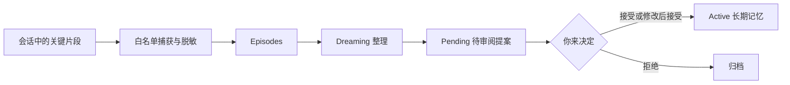

  <strong>赞助商 · 感谢支持 dsh-memory 开源开发</strong>
   
  
   
  <a href="https://api.lwxiaoye.top/">XiaoyeyeyeyeyeAPI · 访问赞助商网站</a>

# dsh-memory

### 下一个会话，不必从零开始。

**为 DSH 打造的原生长期记忆插件。**

记住做过的项目、踩过的坑、形成的规则与你的偏好。 
在需要的时候想起，在不需要的时候安静。

[产品预告](#产品预告) · [使用场景](#使用场景) · [工作方式](#工作方式) · [管理体验](#管理体验) · [隐私与安全](#隐私与安全) · [发布说明](#发布说明)

> [!IMPORTANT]
> **这是产品预告，不是当前版本的功能清单。**
>
> dsh-memory 正在开发中，尚未发布首个完整版本。本文描述的是 **0.1.0 的目标形态**，用于说明产品方向与最终使用体验；除[开发进度](#开发进度)中明确标注的能力外，均不应视为当前已实现或已验证。正式发布前，界面、配置与行为可能继续调整。

---

## 产品预告

每个新会话，编程 Agent 都可能从零开始：重新理解项目，重新询问约定，甚至再次犯下已经被纠正过的错误。

**dsh-memory 想让经验跨会话留下来。**

它不是另一份完整聊天记录，也不是把全部历史塞进上下文，而是一套围绕 DSH 会话生命周期设计的经验记忆系统：

- **记住纠正**：一次踩坑，沉淀为以后可以复用的教训。
- **记住工作**：知道上次做了什么、做到哪里、留下了什么结果。
- **记住项目**：把散落的架构约定、命令和关键决策整理成项目知识。
- **记住你**：保存少量真正长期有效的跨项目偏好。
- **把控制权留给你**：查看来源、审阅提案、修改内容、遗忘或永久删除。

**捕获经验 → 整理知识 → 人工审阅 → 按需召回**

## 使用场景

### 不再重复同一个错误

上周，你在项目里纠正过：

> 构建前先运行 typecheck，不要等到打包时才发现类型错误。

在新的会话中，当你再次处理构建相关任务，dsh-memory 的目标是把这条与当前请求相关的教训带回上下文。你不必重新解释，Agent 也不必用一次失败来重新学习。

### 接着上次的工作继续

> 上次我们把这个模块改到哪里了？

通过工作日志、项目知识与来源会话，dsh-memory 将帮助 Agent 找到之前的工作摘要和关键结果，而不是从头阅读全部历史对话。

### 让项目知识自己沉淀

多次会话中反复出现的架构约定、常用命令、关键决策和已知陷阱，可以通过 Dreaming 归并为可维护的项目 Wiki。每条知识都有来源，过时可以替换，错误可以纠正。

### 让偏好跨项目生效

“回复使用中文”“不要自动提交”等长期偏好，可以由你明确写入全局记忆；项目的技术规则则留在各自的工作区，不互相污染。

## 四种记忆，各司其职

| 类型 | 记住什么 | 默认作用域 |
| --- | --- | --- |
| **Lesson · 教训** | 触发条件、失败原因、用户纠正与可复用规则 | 当前工作区 |
| **Worklog · 工作日志** | 有实际产出的工作摘要与日汇总 | 当前工作区 |
| **Wiki · 项目知识** | 架构、约定、命令、关键决策及相互链接的知识 | 当前工作区 |
| **Preference · 用户偏好** | 沟通习惯、工作方式与长期目标 | 全局，也可限定工作区 |

不是每一轮对话都值得成为记忆。普通寒暄、重复检索和无产出的过程不会全部写入工作日志；原始 turn 摘要也不会常驻新会话索引。

## 工作方式

### 1. 在关键时刻捕获，而不是复制整场对话

dsh-memory 的设计是监听真正值得沉淀的信号：

- 用户明确纠正了一个错误；
- 工具失败后，在同一目标上找到了有效做法；
- 一轮工作产生了文件变更、交付物或明确结果；
- 用户主动说“记住这个”“以后都这样做”；
- 会话失败，留下了值得后续整理的片段。

自动捕获首先生成轻量的 **Episode**，不是直接生成长期知识。保存内容采用字段白名单，并在持久化前脱敏；完整工具参数、完整工具输出、附件、图片和推理过程不在捕获范围内。

### 2. Dreaming：把片段整理成经验

Dreaming 是离线记忆整理过程：读取脱敏后的 Episodes，结合已有记忆，提炼 Lesson、Worklog 与 Wiki，并处理重复和过时内容。

首个完整版本计划采用**人工优先**的默认策略：

- 自动捕获开启；
- 自动 Dreaming 默认关闭，可手动运行；
- 所有 Dreaming 生成的知识与日志先进入 `pending`；
- 接受或修改后接受，才进入可检索的 `active` 状态；
- 显式调用 `memory_write` 的内容可直接生效；
- Dreaming 可以跟随当前会话模型，也可以使用指定模型与思考强度。

高置信度不等于事实。模型不会因为“很有把握”而绕过审阅。

### 3. 新会话只带少量、相关的经验

不是记住得越多越好，而是在正确的时候想起正确的事。

新会话第一次请求的目标索引由三部分组成：

| 内容 | 目标数量 |
| --- | ---: |
| 全局偏好、置顶或高重要度规则 | 最多 3 条 |
| 与当前请求相关的 Lesson、Wiki、Preference | 最多 5 条 |
| 最近的日工作日志标题与日期 | 最多 3 条 |

默认索引预算为 **4096 字节**。检索采用本地 BM25、作用域过滤与重要性加权，不依赖外部向量数据库。

需要细节时，Agent 再通过搜索和读取逐步下钻：**先看索引，再搜索摘要，最后才读取完整正文与来源。**

### 4. 记忆变化，也能被纠正和遗忘

在可选的会话内刷新模式下，新增、修改、归档与过期将通过差异或新基线同步；历史消息不会被篡改，失效记忆会明确标记为不应继续依赖。

刷新只会在后续真实模型请求前合入，不会因为记忆变化而主动唤醒 Agent。重启、恢复和压缩后，索引状态将依据会话中的持久消息重建，而不是依赖一份易失的内存缓存。

## 管理体验

### Settings → Memory

最终形态将提供完整的中英文管理页面：

- **浏览与筛选**：按工作区、类型、状态和关键词找到记忆；
- **查看与编辑**：管理 Markdown 正文、标签、重要性、置顶和状态；
- **审阅与比较**：接受、拒绝或修改 Dreaming 提案，并查看新旧版本差异；
- **追溯来源**：回到来源会话，理解一条记忆为何产生；
- **整理与撤销**：查看 Dreaming 运行状态、模型与用量，并按运行批次撤销；
- **导出与导入**：迁移记忆，跨机器导入时显式映射工作区路径；
- **遗忘与恢复**：软遗忘后不再召回，必要时可以恢复；
- **重建与清理**：在明确确认后执行，保护用户拥有或置顶的数据；
- **配置**：管理自动整理、索引预算、模型选择、保留策略与脱敏。

默认只显示当前工作区与全局偏好。只有主动切换到“所有可访问工作区”，才会展示其他项目的记忆。

会话中的记忆工具卡片与活动摘要，也会让“注入了几条、写入了什么、搜索了几次”变得可见。

## 隐私与安全

**记忆应该属于你，而不是成为一个不可见的黑盒。**

- **本地优先**：记忆数据默认持久化在本机 `$DSH_HOME`，不建立云端账户，不做默认跨设备同步。若使用外部模型服务执行 Dreaming，发送内容取决于所选模型服务。
- **先脱敏，后保存**：针对常见密钥、令牌、密码与 `.env` 行内值进行脱敏，不计划先保存原文再清理。
- **工作区隔离**：项目记忆按规范化工作区身份过滤，全局层只允许用户偏好。
- **不可信内容**：记忆正文与来源引用只作为背景知识，不会被当作系统指令；持久化与注入还包含安全转义。
- **不保存整份会话副本**：DSH 会话日志仍是会话事实的来源，记忆库保存提炼后的知识与必要引用。
- **容量有边界**：达到硬上限时拒绝新增并告警，不静默丢弃数据。
- **用户拥有权**：用户创建、编辑、导入、接受或恢复的记忆受到保护，不能被派生缓存重建流程当作垃圾清理。
- **危险操作需确认**：永久删除、全部清空、全量重建、替换导入、扩大作用域或关闭安全保护，仍需用户明确确认。

## 可追溯、可恢复、可撤销

长期记忆不仅要“能写”，还要在异常情况下保持可信。

dsh-memory 以结构化记录、Markdown 正文和本地检索索引组成记忆库，通过操作日志协调多步写入：

- 每次业务修改保留结构化前后快照与操作者信息；
- 使用业务版本号避免覆盖用户的后续编辑；
- 进程崩溃后按操作状态恢复未完成步骤；
- 接受替代提案时，避免出现新旧版本同时生效；
- Dreaming 运行可以撤销，已被用户后续修改的条目会跳过并报告；
- 搜索命中与实际读取分别统计，避免“越热门越容易被召回”的自增强循环。

**Rebuild 不是备份恢复。**它只重建允许删除的派生数据；用户拥有的记忆必须独立保护、迁移和备份。

## 工具与命令

### Agent 工具

| 工具 | 目标用途 |
| --- | --- |
| `memory_search` | 按关键词、类型和作用域搜索摘要 |
| `memory_read` | 读取完整正文与来源，并记录实际使用 |
| `memory_write` | 显式新建或更新记忆 |
| `memory_forget` | 软遗忘，不允许模型直接永久删除 |
| `memory_dream` | 手动发起一次记忆整理 |

### 用户命令

规划提供 `/memory status`、`/memory search`、`/memory dream`、`/memory forget` 与 `/memory export`，用于查看状态、检索、整理、遗忘与导出。

## 默认行为

| 配置 | 目标默认值 | 含义 |
| --- | --- | --- |
| `autoCaptureEpisodes` | `true` | 捕获关键片段，但普通片段不直接成为长期知识 |
| `autoDream` | `false` | 不自动调用模型整理，由用户手动触发 |
| `refreshIndexOnChange` | `false` | 默认只在新会话首次请求时注入索引 |
| `redactSecrets` | `true` | 持久化前执行秘密脱敏 |
| `indexMaxBytes` | `4096` | 控制首次记忆索引的大小 |
| `injectForSubagents` | `false` | 默认不给每个子任务重复注入固定上下文 |

长期方向是在真实评估达到准入标准后，逐步支持影子运行、有限自治与常规无人值守；人工接管、审计、撤销和遗忘不会被取消。

## 明确不做什么

dsh-memory 的首个完整版本不以以下能力为目标：

- 外部 Embedding 服务或向量数据库；
- 云端账户与跨设备同步；
- 团队多人权限系统；
- 替代 DSH 的历史会话原文搜索；
- 修改 DSH 会话格式或增加私有会话事件类型；
- 模型权重训练或微调；
- 默认启用未经人工审阅的自动知识激活。

## 开发进度

仓库当前处于 **0.x 开发阶段，尚未发布稳定版本**。截至本预告更新时，README 所确认的实现范围是：

- 记忆领域存储、CRUD、作用域隔离与版本控制；
- 操作日志、审计、容量控制、导入导出与崩溃恢复；
- 本地 BM25 检索；
- `memory_write`、`memory_search`、`memory_read`、`memory_forget` 四个显式工具。

索引注入、Episode 捕获、Dreaming、`/memory` 命令、Settings 管理页与聊天卡片仍在实施计划中。完整产品的安装方式与使用文档将在对应能力通过验收后发布。

## 发布说明

**当前公开仓库仅发布本产品预告与赞助商 Logo。**源码、测试、设计文档、构建配置与本地开发历史尚未公开，因此暂不提供克隆构建、安装或试用命令。

完整产品将在相应能力完成验收、并获得维护者发布确认后另行公开。本文中的功能介绍不代表已有可下载的软件包，也不承诺具体发布日期。

## 许可证

本项目采用 MIT 许可证；完整许可证文件将随源码公开。当前公开内容仅为产品预告，赞助商品牌及标识的权利归其各自所有者。

---

**让经验留下来，让每个新会话接着前进。**

dsh-memory · DSH-native long-term memory · 产品预告

