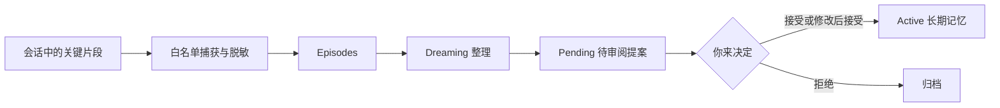

<div align="center">

<picture>
  <source media="(prefers-color-scheme: dark)" srcset="assets/logo-horizontal-dark.svg">
  <source media="(prefers-color-scheme: light)" srcset="assets/logo-horizontal-light.svg">
  
</picture>

### 下一个会话，不必从零开始。

**面向多编码 Agent（Antigravity & DSH）的本地优先长期记忆系统：跨宿主共享记忆内核、原生插件与独立桌面客户端（原 `dsh-memory`）。**

记住做过的项目、踩过的坑、形成的规则与你的偏好。<br>
在需要的时候想起，在不需要的时候安静。

[项目简介](#项目简介) · [使用场景](#使用场景) · [工作方式](#工作方式) · [管理体验](#管理体验) · [隐私与安全](#隐私与安全) · [安装](#安装) · [配置](#配置) · [架构说明](#架构说明) · [发布说明](#发布说明) · [FAQ](#faq)

[](#开发进度)
[](#安装)
[](#许可证)
[](#隐私与安全)

</div>

> [!NOTE]
> **当前为 `0.2.1` 开发版本（0.x），仅通过 GitHub Releases 分发（含 Antigravity 原生插件、DSH Bundle 与 Memloom Desktop 独立桌面端），不发布 npm 包。**
>
> 本文描述的能力与当前仓库实现保持同步；在达到正式稳定版前，界面、配置与行为仍可能调整。详细变更见 [`CHANGELOG.md`](CHANGELOG.md)。

---

<p align="center">
  <strong>赞助商 · 感谢支持 memloom 开源开发</strong>
  <br>
  <a href="https://api.lwxiaoye.top/">
    
  </a>
  <br>
  <a href="https://api.lwxiaoye.top/">XiaoyeyeyeyeyeAPI · 访问赞助商网站</a>
</p>

## 项目简介

每个新会话，编程 Agent 都可能从零开始：重新理解项目，重新询问约定，甚至再次犯下已经被纠正过的错误；不同工具之间，经验也往往彼此割裂。

**memloom（原 `dsh-memory`）想让经验跨会话、跨宿主留下来。**

它不是另一份完整聊天记录，也不是把全部历史塞进上下文，而是一套基于零宿主依赖核心引擎（`src/core/`）的多宿主经验记忆系统，同时等权支持 **Antigravity（AGY）**、**DSH（DeepSeek Harness）** 与 **Memloom Desktop**：

- **记住纠正**：一次踩坑，沉淀为以后可以复用的教训。
- **记住工作**：知道上次做了什么、做到哪里、留下了什么结果。
- **记住项目**：把散落的架构约定、命令和关键决策整理成项目知识。
- **记住你**：保存少量真正长期有效的跨项目偏好。
- **把控制权留给你**：跨宿主统一检索、查看来源、审阅提案、跨端迁移、修改内容、遗忘或永久删除。

<div align="center">

**捕获经验 → 整理知识 → 人工审阅 → 按需召回**

</div>

## 使用场景

### 不再重复同一个错误

上周，你在项目里纠正过：

> 构建前先运行 typecheck，不要等到打包时才发现类型错误。

在新的会话中，当你再次处理构建相关任务，memloom 的目标是把这条与当前请求相关的教训带回上下文。你不必重新解释，Agent 也不必用一次失败来重新学习。

### 接着上次的工作继续

> 上次我们把这个模块改到哪里了？

通过工作日志、项目知识与来源会话，memloom 将帮助 Agent 找到之前的工作摘要和关键结果，而不是从头阅读全部历史对话。

### 让项目知识自己沉淀

多次会话中反复出现的架构约定、常用命令、关键决策和已知陷阱，可以通过 Dreaming 归并为可维护的项目 Wiki。每条知识都有来源，过时可以替换，错误可以纠正。

### 让偏好跨项目与跨宿主生效

“回复使用中文”“不要自动提交”等长期偏好，可以由你明确写入全局记忆；项目的技术规则则留在各自的工作区，不互相污染，并可通过 **Memloom Desktop** 的迁移桥在 AGY 与 DSH 之间无损互通。

## 四种记忆，各司其职

| 类型 | 记住什么 | 默认作用域 |
| --- | --- | --- |
| **Lesson · 教训** | 触发条件、失败原因、用户纠正与可复用规则 | 当前工作区 |
| **Worklog · 工作日志** | 有实际产出的工作摘要与日汇总 | 当前工作区 |
| **Wiki · 项目知识** | 架构、约定、命令、关键决策及相互链接的知识 | 当前工作区 |
| **Preference · 用户偏好** | 沟通习惯、工作方式与长期目标 | 全局，也可限定工作区 |

不是每一轮对话都值得成为记忆。普通寒暄、重复检索和无产出的过程不会全部写入工作日志；原始 turn 摘要默认不进入新会话索引，只在日工作日志不足 3 条时按最近 7 天兜底进入，且只取标题与日期。

## 工作方式

### 1. 在关键时刻捕获，而不是复制整场对话

memloom 跨宿主监听真正值得沉淀的信号：

- 用户明确纠正了一个错误；
- 工具失败后，在同一目标上找到了有效做法；
- 一轮工作产生了文件变更、交付物或明确结果；
- 用户主动说“记住这个”“以后都这样做”；
- 会话失败，留下了值得后续整理的片段。

自动捕获首先生成轻量的 **Episode**，不是直接生成长期知识。保存内容采用字段白名单，并在持久化前脱敏；完整工具参数、完整工具输出、附件、图片和推理过程不在捕获范围内。

满足条件的一轮工作（文件变更、交付物、用户纠正或明确完成结果）会生成确定性的 `worklog(turn)`，不调用模型。标题优先取助手结论中的第一句有效内容，其次取用户请求的第一行；问句与明显低信息片段不会成为标题，最长 80 字符；标题仍可能偏短，需人工审阅。正文按“结论优先”分配 4096 字节：`## Result` 先保留最多 2048 字节且不会被长请求挤掉，`## Request` 最多 1024 字节，剩余空间才给文件清单与工具失败；被裁剪的段落以 `…[truncated]` 标记。

### 2. Dreaming：把片段整理成经验

Dreaming 是离线记忆整理过程：读取脱敏后的 Episodes，结合已有记忆，提炼 Lesson、Worklog 与 Wiki，并处理重复和过时内容（AGY 通过两阶段 `prepare` / `commit` 与内置 Skills 驱动；DSH 支持后台排队或跟随会话模型运行）。



默认采用**人工优先**策略：

- 自动捕获开启；
- 自动 Dreaming 默认关闭，可手动运行；
- 所有 Dreaming 生成的知识与日志先进入 `pending`；
- 接受或修改后接受，才进入可检索的 `active` 状态；
- 显式写入（`memory_write`）的内容可直接生效；
- 在 DSH 中 Dreaming 可以跟随当前会话模型或指定模型与思考强度；在 AGY 中无需额外外部模型 API Key。

高置信度不等于事实。模型不会因为“很有把握”而绕过审阅。

Dreaming 的可靠性行为（已实现）：

- **启动恢复与冷会话对账**：进程重启后，已持久化的 `queued` dream 会按原 dream id 重新排队；中断在运行中的 dream 会被标记失败，已领取的 episode 回到可重试队列，不会重复生成提案。开启 `autoDream` 时，启动还会对最近 7 天的冷会话做一次对账，补捕遗漏的会话事件；`autoDream=false` 时既不读取冷会话，也不因此调用模型。
- **失败分类、退避与暂停**：鉴权、额度类错误会立即暂停自动 dream；限流、超时、网络类错误按 60 秒、180 秒退避，连续三次后暂停。暂停与退避只存在于当前进程，重启后自动恢复；手动 dream 不受暂停影响，成功的手动 dream 会解除暂停。
- **健康检查与证据分级**：每次整理前，先在本地计算待处理 episode、重复工具失败、待审阅提案、重复标题与缺失日汇总，并作为提示交给模型。模型只使用 episode 中有依据的内容：用户明确说过的算证据并引用 episode id；缺少工具结果或用户陈述支持的助手断言标为未验证或省略；一条记忆只讲一个主题，只记录环境给不回来的东西（教训、做通的路子、验证过的规则、坑与进行中的计划），不记录代码、文件内容、当前配置值、git 历史或命令输出。

### 3. 新会话只带少量、相关的经验

不是记住得越多越好，而是在正确的时候想起正确的事。

新会话第一次请求的目标索引由四部分组成：

| 内容 | 目标数量 |
| --- | ---: |
| 全局偏好（`preference`） | 最多 5 条 |
| 置顶或高重要度的工作区规则 | 最多 3 条 |
| 与当前请求相关的 Lesson、Wiki、Preference | 最多 5 条 |
| 最近的日工作日志标题与日期；不足 3 条时用最近 7 天内的工作日志标题兜底 | 最多 3 条 |

默认索引预算为 **4096 字节**。检索采用本地 BM25、作用域过滤与重要性加权，不依赖外部向量数据库。

“最近工作”优先使用日汇总；没有足够日汇总时，当前工作区内最近 7 天创建的 `worklog(turn)` 会补足，最多 3 条，只带标题与日期，不注入正文。归档、过期或其他工作区的记录不会进入。

需要细节时，Agent 再通过搜索和读取逐步下钻：**先看索引，再搜索摘要，最后才读取完整正文与来源。**

### 4. 记忆变化，也能被纠正和遗忘

在可选的会话内刷新模式下，新增、修改、归档与过期将通过差异或新基线同步；历史消息不会被篡改，失效记忆会明确标记为不应继续依赖。

刷新只会在后续真实模型请求前合入，不会因为记忆变化而主动唤醒 Agent。重启、恢复和压缩后，索引状态将依据会话中的持久消息或持久化状态重建，而不是依赖易失内存缓存。

## 管理体验

`0.2.1` 提供三种互补的管理方式，覆盖多端协同桌面台、宿主内置界面与对话内工作流：

### 1. Memloom Desktop（跨宿主独立桌面客户端）

面向 **Antigravity（AGY）** 与 **DSH** 的统一可视化工作台（`--ml-*` 双层纸墨浮岛设计系统，零原生表单控件，支持浅色 / 深色 / 跟随系统与中 / 英文切换，详见 [`docs/desktop.md`](docs/desktop.md)）：

- **全部记忆**：支持跨全宿主联邦聚合 BM25 检索与单宿主主从双栏管理、新建记忆与编辑（草稿保护 + 外部变更冲突恢复）、Markdown 排版检视与悬浮批量操作条；
- **待审阅提案**：跨宿主汇总全部 `pending` 提案，提供 `supersedes` 版本对比与 `A`（批准）/ `E`（编辑后接受）/ `R`（拒绝）快捷键；
- **跨端迁移**：经纬桥接器支持在 AGY 与 DSH 之间执行单条/多选 `merge` 迁移及带逐工作区路径映射、风险确认门禁的 `replace` 迁移向导；
- **整理与审计**：按宿主查看 `DreamRun` 整理历史（支持按运行批次撤销）与不可变 `AuditRecord` Diff 时间线；
- **宿主配置与写保护**：AGY 宿主可直接编辑 23 项配置并执行备份重建；DSH 宿主运行期间自动进入只读保护态（`WriteGuard`），写前执行 SHA-256 外部变更检测与自动快照备份；全局支持 `Ctrl/⌘K` 命令面板。

### 2. DSH Settings → Memory（内置 4-Tab 管理页）

在 DSH 宿主内提供**统一顶栏 + 4 个 Tab 分区**（`记忆库`、`待审阅`、`导入与导出`、`设置`）：

- **顶栏概览与导航**：切换工作区、点击计数跳转、查看索引容量占用条，并固定提供「新建记忆」「立即整理（`Dream now`）」「刷新」操作；
- **记忆库、待审阅与批量整理**：关键词搜索与类型/状态筛选、居中 Modal 详情编辑、提案行级 Diff / 并排对比与「保存并接受」、查看并撤销最近 Dream 批次；
- **导入导出与分组设置**：导入前文件摘要预览与逐工作区路径映射、「自动整理 / 索引与注入 / 数据保留 / 隐私与安全」4 组设置及未保存确认；永久删除、全部清空与全量重建不在此页直接暴露；
- **会话指示**：记忆工具沿用 DSH 原生工具调用行，回答下方用量/时间旁仅以小字展示非零的本会话注入、写入与搜索累计次数。

### 3. Antigravity（AGY）内置 Skills 与 MCP 管理工具

- **对话工作流**：内置 `memory`、`memory-dream` 与 `memory-review` 三项 Skill，可直接通过自然语言或命令驱动两阶段整理与逐条提案审阅；
- **敏感操作确认门禁**：跨工作区检索、`scope: 'all'` 写入、文件导入导出、按批撤销 Dream 与清空重建等敏感操作均由 `PreToolUse` Hook 通过 `force_ask` 弹窗强制确认（详见 [`docs/agy.md`](docs/agy.md)）。

## 隐私与安全

**记忆应该属于你，而不是成为一个不可见的黑盒。**

- **本地优先**：数据默认完全保存在本机（AGY 默认在 `${PLUGIN_DATA}/memory.json`，DSH 默认在 `$DSH_HOME/storages/memory.json`），不建立云端账户，不做默认跨设备同步。若使用外部模型服务执行 Dreaming，发送内容取决于所选模型服务。
- **先脱敏，后保存**：针对常见密钥、令牌、密码与 `.env` 行内值进行脱敏，不先保存原文再清理。显式 `memory_write` 命中私钥、常见云服务 API key、GitHub/Slack token 等强特征密钥时会直接拒写，并提示记录凭据的配置位置；捕获、dream 与导入路径仍按脱敏规则替换后保存。`redactSecrets=false` 只关闭显式写入、dream 与导入的脱敏，捕获与 worklog 文本始终脱敏。
- **工作区隔离**：项目记忆按规范化工作区身份过滤（含 AGY `PreToolUse` nonce 与 MCP `roots/list` 鉴权及全局降级保护），全局层只允许用户偏好。替换导入要求文件中的每个工作区都有映射，缺失时整次替换被拒绝。
- **不可信内容**：记忆正文与来源引用只作为背景知识，不会被当作系统指令；持久化与注入还包含安全转义。
- **不保存整份会话副本**：宿主会话日志（DSH 会话日志与 AGY `transcript.jsonl`）仍是会话事实的来源，记忆库仅保存提炼后的知识与必要引用。
- **容量有边界**：达到硬上限时拒绝新增并告警，不静默丢弃数据。active 溢出只会自动归档未审阅的派生记录，用户拥有与置顶的记录受保护。
- **用户拥有权**：用户创建、编辑、导入、接受或恢复的记忆受到保护，不能被派生缓存重建流程当作垃圾清理。
- **危险操作需确认**：永久删除、全部清空、全量重建、替换导入、扩大作用域或关闭安全保护，均需明确确认（桌面端/管理页弹窗、AGY `force_ask` 门禁或 Host API 确认参数）；导出文件包含个人记忆，界面会提示妥善保管。

## 可追溯、可恢复、可撤销

长期记忆不仅要“能写”，还要在异常情况下保持可信。

memloom 以结构化记录、Markdown 正文和本地检索索引组成记忆库，通过操作日志协调多步写入：

- 每次业务修改保留结构化前后快照与操作者信息；
- 使用业务版本号（`contentRevision`）避免覆盖用户的后续编辑；
- 进程崩溃后按操作状态恢复未完成步骤；
- 接受替代提案时，避免出现新旧版本同时生效；
- Dreaming 运行可以撤销，已被用户后续修改的条目会跳过并报告；
- 搜索命中与实际读取分别统计，避免“越热门越容易被召回”的自增强循环。

**Rebuild 不是备份恢复。**它只重建允许删除的派生数据；用户拥有的记忆必须独立保护、迁移和备份。

## 工具与命令

### 核心模型工具（DSH & AGY 共享能力）

| 工具 | 目标用途 |
| --- | --- |
| `memory_search` | 按关键词、类型和作用域搜索摘要（省略 `query` 时列举高优摘要） |
| `memory_read` | 读取一条可召回记忆的完整正文与来源，并记录实际使用 |
| `memory_write` | 显式新建或更新记忆，直接 `active`；工具描述内含“何时写/何时不写”的准则 |
| `memory_forget` | 软遗忘，不允许模型直接永久删除 |
| `memory_dream` | 手动发起一次记忆整理（DSH）或查看待整理队列 |
| `memory_organize` | 手动整理已有 active 记忆，产出去重/合并提案 |

### 宿主专属交互

- **Antigravity（AGY）**：通过 zero-dependency Stdio MCP Server 暴露 **12 个常规工具 + 8 个敏感管理工具**（含 `memory_dream_prepare` / `memory_dream_commit`、`memory_organize_prepare` / `memory_organize_commit`、提案审阅与撤销工具等），配合 `PreInvocation`、`Stop` 与 `PreToolUse` Hooks 及 `memory` / `memory-dream` / `memory-review` 3 个内置 Skills（完整清单见 [`docs/agy.md`](docs/agy.md)）。
- **DSH**：提供 `/memory status`、`/memory search`、`/memory dream`、`/memory organize`、`/memory forget` 与 `/memory export` 命令（`export` 返回摘要，完整 JSON 导出在 Settings → Memory 或 Memloom Desktop 中完成）。

## 默认行为

| 配置 | 目标默认值 | 含义 |
| --- | --- | --- |
| `autoCaptureEpisodes` | `true` | 捕获关键片段，但普通片段不直接成为长期知识 |
| `autoDream` | `false` | 不自动调用模型整理，由用户手动触发 |
| `refreshIndexOnChange` | `false` | 默认只在新会话首次请求时注入索引 |
| `redactSecrets` | `true` | 持久化前执行秘密脱敏 |
| `indexMaxBytes` | `4096` | 控制首次记忆索引的大小 |
| `injectForSubagents` | `false` | 默认不给每个子任务重复注入固定上下文 |

长期方向是在真实评估达到准入标准后，逐步支持影子运行、有限自治与常规无人值守；人工接管、审计、撤销和遗忘不会被取消。

## 安装

> memloom **仅通过 GitHub 仓库与 GitHub Releases 分发（不发布 npm 包）**。`0.2.1` 仍处于 0.x 开发阶段。

**通用环境要求**：Node.js `>=24.9.0`（从源码构建需额外准备 `pnpm`）。各端产物从 [GitHub Releases v0.2.1](https://github.com/JiaMingWang-CN/memloom/releases/tag/v0.2.1) 获取或本地构建，三端产物互不混用且隔离校验：

### 方式 A：Antigravity（AGY）原生插件

- **从 Release 安装（推荐）**：下载 [`memloom-agy-plugin-0.2.1.zip`](https://github.com/JiaMingWang-CN/memloom/releases/download/v0.2.1/memloom-agy-plugin-0.2.1.zip)，解压至 `~/.gemini/config/plugins/memloom` 并在 `plugins.json` 中启用（零外部 `node_modules` 依赖，仅需本机 Node.js）。
- **从源码构建**：
  ```bash
  git clone https://github.com/JiaMingWang-CN/memloom.git
  cd memloom && pnpm install
  pnpm build:agy && pnpm pack:agy:check   # 生成并校验 dist/agy-plugin/
  ```

### 方式 B：DSH（DeepSeek Harness）Bundle 插件

要求本机安装版 DSH `0.2.2-rc.5`（`package.json` 的 `engines.dsh` 声明兼容范围 `^0.2.2-rc.5`）：

- **从 Release 安装（推荐）**：
  ```bash
  dsh plugin --profile desktop add https://github.com/JiaMingWang-CN/memloom/releases/download/v0.2.1/memloom-0.2.1.tgz
  ```
  也可下载 `memloom-0.2.1.tgz` 后在 DSH 的 Plugins 页面手动安装，完成后重启 DSH。
- **从源码构建与调试**：
  ```bash
  pnpm build          # 产出 dist/host 与 dist/client.js
  dsh plugin --profile desktop add link:./
  # 或执行 pnpm pack 生成 memloom-0.2.1.tgz
  ```
  最小 patch 配置示例见 [`examples/cordis.patch.yml`](examples/cordis.patch.yml)，卸载可执行 `dsh plugin --profile desktop remove memloom`。

### 方式 C：Memloom Desktop（独立桌面客户端）

- **Windows `win-x64` 安装程序**：下载 Release 中的 [`memloom-desktop-0.2.1-win-x64-setup.exe`](https://github.com/JiaMingWang-CN/memloom/releases/download/v0.2.1/memloom-desktop-0.2.1-win-x64-setup.exe) 安装运行（支持同时发现并管理本机 AGY 与 DSH 记忆库）。
- **免签名本地浏览器应用模式 / 源码打包**：
  ```bash
  pnpm run start:desktop   # 通过本机 Node.js + Edge App 窗口零拦截启动（共享 desktop-state.json）
  # 或构建 Electron 产物与 Windows NSIS 安装程序：
  pnpm run build:desktop && pnpm run pack:desktop:check
  pnpm --dir desktop install && pnpm --dir desktop run pack:win
  ```

详见 [`docs/agy.md`](docs/agy.md) 与 [`docs/desktop.md`](docs/desktop.md)。

## 快速开始

1. **写入一条记忆**：在 AGY 或 DSH 新会话中让 Agent 记住一条经验（模型调用 `memory_write`），或在 **Memloom Desktop** / DSH Settings → Memory 中新建。显式写入直接生效。
2. **在新会话召回**：开启新会话时，memloom 会在第一次请求前注入一份小型记忆索引；Agent 也可以调用 `memory_search` 搜索摘要，再用 `memory_read` 读取完整正文与来源。
3. **整理与审阅**：在 AGY 中通过 `memory-dream` / `memory-review` Skill，或在 DSH 中运行 `/memory dream` / 点击 `Dream now`，也可直接在 **Memloom Desktop**「待审阅提案」中集中审阅；整理产物先进入 `pending`，确认后才转为可检索的长期记忆。
4. **遗忘与跨端迁移**：使用 `memory_forget` 软遗忘（必要时可恢复），或通过 **Memloom Desktop** 迁移桥在 AGY 与 DSH 之间 `merge` / `replace` 迁移。

一个典型闭环：

```text
> 构建前先跑 typecheck，避免打包时才发现类型错误。
（Agent 调用 memory_write 写入一条 lesson）

（新会话）> 这次要打包发布，先做什么？
（索引中带回了“构建前先跑 typecheck”的教训）
```

## 配置

共享内核配置默认值由 [`src/core/config.ts`](src/core/config.ts) 统一定义，完整字段见 [`docs/configuration.md`](docs/configuration.md)。`0.2.1` 的关键默认行为：

| 配置 | 默认值 | 含义 |
| --- | --- | --- |
| `autoDream` | `false` | 默认不自动调用模型整理，由用户手动触发。 |
| `refreshIndexOnChange` | `false` | 默认只在新会话首次请求时注入索引。 |
| `autoCaptureEpisodes` | `true` | 自动捕获关键片段，但普通片段不直接成为可检索知识。 |
| `indexMaxBytes` | `4096` | 首次记忆索引的字节预算。 |
| `redactSecrets` | `true` | 持久化前执行秘密脱敏。 |
| `injectForSubagents` | `false` | 默认不给每个子任务注入固定上下文。 |

在 AGY 中可通过 `${PLUGIN_DATA}/config.json` 或 **Memloom Desktop** 宿主配置页可视化调整全部 23 项配置；在 DSH 中可通过 profile patch YAML 覆盖：

```yaml
- insert:
    - id: memloom
      name: memloom
      config:
        autoDream: false
        autoCaptureEpisodes: true
        refreshIndexOnChange: false
```

## 架构说明

memloom 采用同仓共享内核的多宿主分层架构，核心记忆引擎（`src/core/`）零宿主依赖，统一支撑 AGY 原生插件、DSH Bundle 与 Memloom Desktop：

- **Shared Core（`src/core/` + `src/shared/`）**：承载 6 表领域模型（记忆、episode、dream、审计、操作日志、会话游标）、BM25 检索、操作日志崩溃恢复、容量与脱敏策略、导入导出与两阶段 Dream/Organize 引擎。
- **AGY 原生插件（`src/agy/`）**：以跨进程 `.memory.lock` 文件锁 JSON 存储（`${PLUGIN_DATA}/memory.json`）、20 个分级 MCP 工具、统一 Hooks（`PreInvocation` / `Stop` / `PreToolUse`）及内置 Skills 打包为自包含目录 `dist/agy-plugin/`。
- **DSH 插件（`src/host/` + `src/client/`）**：以单一 `MemoryService` 注册 `memory` 服务（持久化至 `storageDomain`，默认 `$DSH_HOME/storages/memory.json`），提供 6 个原生工具、`/memory` 命令与 Settings → Memory 管理页（`ctx.remote.memory.*`）。
- **Memloom Desktop（`src/desktop/` + `desktop/`）**：采用独立桌面设计系统（`--ml-*` 双主题浮岛工作台、自定义精工控件与官方 DSH / AGY 宿主标识），以无损双格式读写（`dsh-unit` 与 `agy-flat`）、DSH 运行态只读写保护（`WriteGuard`）、写前自动快照备份、跨端聚合检索与跨库迁移桥构建 Electron 桌面客户端。
- **一致性与兼容性**：多表写入均通过 `operations` 状态机与 `contentRevision` 乐观并发控制实现崩溃恢复；兼容导入旧版 `dsh-memory` 导出 JSON。

详见 [`docs/architecture.md`](docs/architecture.md)、[`docs/agy.md`](docs/agy.md)、[`docs/desktop.md`](docs/desktop.md)、[`docs/memory-model.md`](docs/memory-model.md)、[`docs/dreaming.md`](docs/dreaming.md) 与 [`docs/security.md`](docs/security.md)。

## 明确不做什么

memloom 的 `0.x` 阶段不以以下能力为目标：

- 外部 Embedding 服务或向量数据库；
- 云端账户与跨设备同步；
- 团队多人权限系统；
- 替代宿主（AGY / DSH）的历史会话原文搜索；
- 修改宿主会话格式或增加私有会话事件类型；
- 模型权重训练或微调；
- 默认启用未经人工审阅的自动知识激活。

## 开发进度

仓库当前处于 **`0.2.1` 开发版本（0.x）**，已实现并完成自动化测试的范围包括：

- 零宿主依赖共享核心（`src/core/`）：领域存储、CRUD、作用域隔离、版本控制、操作日志、审计、容量控制、导入导出与崩溃恢复；
- 本地 BM25 检索、新会话记忆索引注入（基线与可选增量刷新）、Episode 白名单捕获、条件 `worklog(turn)`、口头“记住”直接写入与 Dreaming / Organize 整理闭环；
- Dream 队列启动恢复与冷会话启动对账、失败分类/退避/进程内暂停、健康检查、证据分级、worklog 预算、强密钥拒写与按批撤销；
- **Antigravity（AGY）原生插件**：跨进程文件锁持久化、20 个分级 MCP 工具、`PreInvocation`/`Stop`/`PreToolUse` Hooks、两阶段整理 Skills 与自包含构建校验（[`docs/agy.md`](docs/agy.md)）；
- **DSH 插件 Bundle**：6 个结构化原生工具、`/memory` 命令、Settings → Memory 4-Tab 管理页、会话用量小字与 `engines.dsh` 兼容声明；
- **Memloom Desktop（`0.2.1` 全新重设计）**：`--ml-*` 浮岛工作台与零原生控件、官方 DSH / AGY 矢量 Logo、五大核心视图（全部记忆、待审阅提案、跨端迁移桥、整理与审计、宿主配置）、DSH `WriteGuard` 并发写保护、写前 20 份自动备份与 Windows `win-x64` NSIS 安装程序（[`docs/desktop.md`](docs/desktop.md)）。

当前默认策略保持 `autoDream=false`、`refreshIndexOnChange=false`、`autoCaptureEpisodes=true`；安装与使用见上文[安装](#安装)与[快速开始](#快速开始)。

## 发布说明

- **分发渠道**：本项目仅通过 [GitHub Releases](https://github.com/JiaMingWang-CN/memloom/releases) 分发 **`memloom-<version>.tgz`**（DSH Bundle）、**`memloom-agy-plugin-<version>.zip`**（AGY 原生插件）与 **`memloom-desktop-<version>-win-x64-setup.exe`**（Windows 桌面端）及源码仓库，**不发布 npm 包**。
- **变更记录**：详细变更见 [`CHANGELOG.md`](CHANGELOG.md)。

## FAQ

**memloom 现在可以用来长期使用吗？**
仓库处于 `0.2.1` 开发版本（0.x），尚未发布稳定版。功能可用且有自动化测试覆盖，但接口、配置与界面仍可能调整。

**会自动整理我的记忆吗？**
默认不会。`autoDream=false`，由你手动触发（AGY 可通过 `memory-dream` Skill，DSH 可运行 `/memory dream` 或点击 `Dream now`）；即使开启自动整理，产物也先进入 `pending` 待审阅。

**我说“记住”会直接写入吗？**
会。模型没有在本轮调用 `memory_write` 时，明确的“记住/以后都…”会直接生成 `active` 记忆（偏好类为 `preference`，否则 `lesson`）；自动 dream/organize 的产物仍然先进入待审阅。

**整理出来的记忆会直接生效吗？**
不会。所有 dream 生成的 `lesson` / `wiki` / `worklog(daily)` 一律 `pending`，在 Memloom Desktop、AGY `memory-review` Skill 或 DSH Settings → Memory 接受或修改后接受后才可检索。

**支持语义搜索或向量检索吗？**
不支持。检索使用本地 BM25，不做向量检索，也不依赖外部 embedding 服务。

**记忆会跨设备同步吗？**
不会。数据完全保存在本机各自宿主目录（AGY `${PLUGIN_DATA}/memory.json`、DSH `$DSH_HOME/storages/memory.json`），没有云端账户或跨设备同步。

**不同项目或不同宿主的记忆会互相污染吗？**
不会。记忆按规范化 `workspaceKey` 隔离，AGY 与 DSH 默认使用各自独立的磁盘存储；在 Memloom Desktop 中可同时查看，默认按宿主和工作区清晰标识。

**如何备份或跨端迁移记忆？**
最推荐直接在 **Memloom Desktop** 的「跨端迁移」工作台完成 AGY ⇄ DSH 间的 `merge` 或逐工作区映射 `replace` 迁移；也可以导出完整 JSON 再逐工作区映射导入。`/memory export` 只返回导出摘要，不写文件。

**卸载插件会删除我的记忆吗？**
禁用或卸载 AGY / DSH 插件后会停止注入与捕获，历史会话保留；记忆数据保留在各自本地目录中，可按需手动清理。

## 许可证

本项目采用 [MIT 许可证](LICENSE)。赞助商品牌及标识的权利归其各自所有者。

---

<div align="center">

**让经验留下来，让每个新会话接着前进。**

memloom · Local-first long-term memory · 0.2.1-dev

</div>
